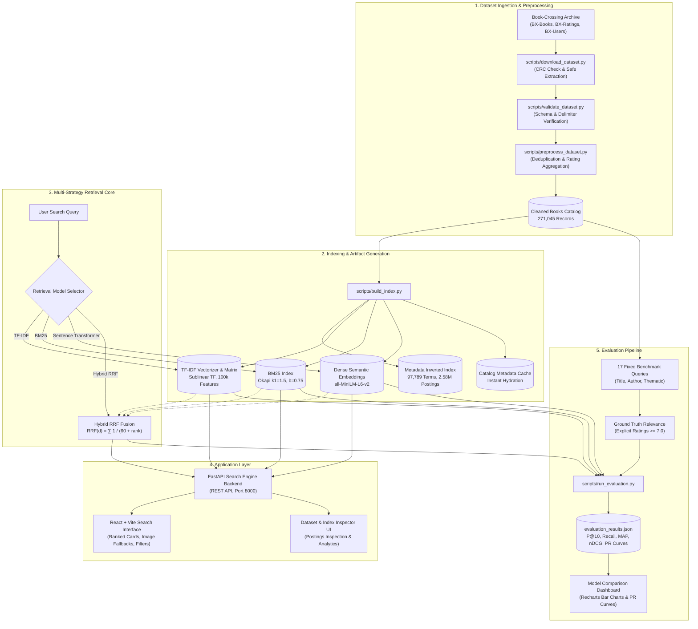

# Book Search using Book-Crossing | Information Retrieval System

[](https://www.python.org/)
[](https://fastapi.tiangolo.com/)
[](https://react.dev/)
[](https://vitejs.dev/)
[](file:///d:/IR-project/backend/tests/)

A complete, production-grade Information Retrieval (IR) system that indexes the Book-Crossing catalog (~271,000 books, ~1.15 million user ratings, and ~278,000 users). The project implements lexical retrieval, dense semantic retrieval, and hybrid rank fusion, providing an interactive React interface, an automated benchmark evaluation suite, and dataset exploration analytics.

**GitHub Repository:** [https://github.com/garvshrivastava24/IR-project.git](https://github.com/garvshrivastava24/IR-project.git)

---

## Table of Contents

1. [Project Overview](#project-overview)
2. [Feature Highlights](#feature-highlights)
3. [Technology Stack](#technology-stack)
4. [Dataset Acquisition & Validation](#dataset-acquisition--validation)
5. [System Architecture](#system-architecture)
6. [Retrieval Algorithms](#retrieval-algorithms)
7. [Empirical Evaluation & Performance](#empirical-evaluation--performance)
8. [Project Structure](#project-structure)
9. [Installation & Windows Setup](#installation--windows-setup)
10. [API Documentation](#api-documentation)
11. [Automated Testing](#automated-testing)
12. [Limitations & Future Enhancements](#limitations--future-enhancements)

---

## 1. Project Overview

Finding books across massive catalogs requires balancing exact textual matching (titles, authors, ISBNs) with conceptual understanding (genres, themes, synonyms). 

This project explores this challenge by building an Information Retrieval system on the Book-Crossing corpus. It implements and compares four distinct retrieval models:
- **Lexical Models:** Term Frequency-Inverse Document Frequency (**TF-IDF**) and Okapi **BM25**.
- **Dense Semantic Model:** **Sentence Transformer** (`all-MiniLM-L6-v2`) dense vector search.
- **Hybrid Fusion Model:** **Reciprocal Rank Fusion (RRF)** uniting lexical and semantic rankings.

The system includes a **FastAPI** backend with automated caching, a **React (Vite)** interface with live search and evaluation dashboards, a genuine **metadata inverted index**, and an empirical evaluation pipeline measuring **Precision@10, Recall@10, MAP, nDCG@10**, and **11-point interpolated Precision-Recall curves**.

---

## 2. Feature Highlights

- **Automated Dataset Ingestion:** Resilient 3-tier downloader with checksum validation, safe ZIP extraction, delimiter/encoding detection, and schema verification.
- **Text Preprocessing Pipeline:** Unicode normalization, lowercasing, alphanumeric tokenization, NLTK stop-word removal, and Porter stemming for lexical retrieval, alongside unstemmed linguistic formatting for transformers.
- **Metadata Inverted Index:** In-memory postings index with term frequencies ($TF$), document frequencies ($DF$), vocabulary lookup, and query inspection.
- **Four Ranking Algorithms:**
  - TF-IDF with sublinear term-frequency scaling.
  - Okapi BM25 with configurable saturation ($k_1=1.5$) and length normalization ($b=0.75$).
  - Dense Sentence Transformer cosine similarity over 384-dimensional unit-normalized embeddings.
  - Hybrid Reciprocal Rank Fusion ($k=60$) combining component model ranks.
- **Interactive Search Interface:** Modern React frontend featuring real-time query pills, author and publication year filters, latency badges, and book cards with image fallback handling.
- **Model Comparison Dashboard:** Recharts bar charts for metric comparisons and multi-line 11-point interpolated precision-recall graphs.
- **Dataset Analytics & Explorer:** Interactive distributions of publication years, user rating values (distinguishing explicit ratings from implicit zeros), and top authors/publishers.
- **Inverted Index Inspector:** Live debugging tool displaying tokenization, Porter stemming, matching vocabulary, and postings lists for any search query.
- **Automated Test Suite:** 37 pytest tests verifying preprocessing, indexing, retrieval math, evaluation formulas, and API endpoints.

---

## 3. Technology Stack

### Backend
- **Python 3.11+ / 3.14**
- **FastAPI:** High-performance asynchronous REST API framework
- **Uvicorn:** ASGI web server
- **pandas & NumPy:** Data cleaning, manipulation, and vectorized matrix math
- **scikit-learn:** `TfidfVectorizer` and sparse matrix cosine similarity
- **rank-bm25:** Okapi BM25 implementation
- **sentence-transformers & PyTorch:** Pretrained `all-MiniLM-L6-v2` transformer model
- **NLTK:** Tokenization, English stop-words, and PorterStemmer
- **pyarrow:** High-performance columnar parquet storage
- **requests & tqdm:** Streaming downloads and progress visualization

### Frontend
- **React 18:** Modern functional UI with state hooks
- **Vite:** Next-generation frontend build tooling
- **Axios:** Promise-based HTTP client
- **Recharts:** Composable charting library for bar and line curves
- **Lucide-React:** Clean, modern icon set
- **CSS3:** Custom responsive layout system using CSS variables, Flexbox, and Grid

### Testing & Verification
- **pytest:** Unit and integration test runner
- **FastAPI TestClient / httpx:** End-to-end API route testing

---

## 4. Dataset Acquisition & Validation

The system uses the historical **Book-Crossing** dataset collected by Cai-Nicolas Ziegler from the Book-Crossing community in 2004.

- **Primary Archive Source:** `https://cdn.freecodecamp.org/project-data/books/book-crossings.zip`
- **Official Documentation:** [GroupLens Book-Crossing Dataset](https://grouplens.org/datasets/book-crossing/)

### Core Files & Audited Counts
The raw dataset consists of three semicolon-delimited CSV files using Latin-1 encoding:

| Dataset File | File Size | Raw Parsed Records | Validated Schema |
| :--- | :---: | :---: | :--- |
| `BX-Books.csv` | 74.18 MB | **271,379** | `ISBN`, `Book-Title`, `Book-Author`, `Year-Of-Publication`, `Publisher`, `Image-URL-S`, `Image-URL-M`, `Image-URL-L` |
| `BX-Book-Ratings.csv` | 29.26 MB | **1,149,780** | `User-ID`, `ISBN`, `Book-Rating` (433,671 explicit $>0$, 716,109 implicit $=0$) |
| `BX-Users.csv` | 11.72 MB | **278,858** | `User-ID`, `Location`, `Age` |

*Note: The figures above reflect the audited local dataset files; other community mirrors or subsets may exhibit slight variations.*

### Data Cleaning & Deduplication
- **ISBN String Preservation:** ISBNs are strictly preserved as strings to protect leading zeros (e.g., `0195153448`) and alphanumeric checksum digits (e.g., `034545104X`).
- **Cleaning Filters:** Dropped records with missing titles and removed 315 duplicate ISBN entries.
- **Cleaned Catalog:** Retained exactly **271,045** clean book records stored in [`backend/data/processed/books_cleaned.parquet`](file:///d:/IR-project/backend/data/processed/books_cleaned.parquet).
- **Implicit vs. Explicit Feedback:** Ratings with a value of `0` represent implicit feedback (e.g., interaction/ownership without a review score) and are correctly treated as neutral rather than negative.
- **Dense Embedding Scope:** On CPU environments, dense semantic embeddings are generated for the top **10,000** most active/rated catalog titles (~3.69% of the catalog), while TF-IDF, BM25, and the Inverted Index index the full **271,045** titles. The project also provides a resumable chunked embedding script (`--full-dense`) for full-catalog generation.

---

## 5. System Architecture

The following diagram illustrates the complete data flow, from raw Book-Crossing ingestion to live retrieval and empirical evaluation:



---

## 6. Retrieval Algorithms

### 1. TF-IDF (Term Frequency — Inverse Document Frequency)
TF-IDF calculates importance weights for words based on their frequency within a document relative to their inverse document frequency across the corpus:
$$\text{TF-IDF}(t, d) = (1 + \log \text{TF}(t, d)) \times \log \left(\frac{1 + N}{1 + \text{DF}(t)}\right)$$
- **Vectorizer:** Sublinear term frequency scaling fitted over 100,000 unigram/bigram vocabulary features.
- **Scoring:** Sparse cosine similarity via matrix dot product between document vectors and the query vector.
- **Characteristics:** Fast and precise for exact keyword searches, but cannot capture semantic synonyms or paraphrases.

### 2. BM25 (Best Matching 25)
BM25 is a probabilistic ranking function that improves upon TF-IDF by adding non-linear term frequency saturation and document-length penalization:
$$\text{Score}_{\text{BM25}}(D, Q) = \sum_{q \in Q} \text{IDF}(q) \cdot \frac{f(q, D) \cdot (k_1 + 1)}{f(q, D) + k_1 \cdot \left(1 - b + b \cdot \frac{|D|}{\text{avgdl}}\right)}$$
- **Parameters:** $k_1 = 1.5$ (term frequency saturation limit) and $b = 0.75$ (document length normalization).
- **Characteristics:** Highly robust against keyword stuffing and varying document lengths; consistently superior lexical performance.

### 3. Sentence Transformer (Dense Semantic Retrieval)
Uses the pretrained deep transformer `sentence-transformers/all-MiniLM-L6-v2` to map book metadata into a 384-dimensional continuous vector space:
- **Vector Normalization:** Vectors are $L_2$-normalized so cosine similarity simplifies to a dot product:
  $$\text{Cosine Similarity}(u, v) = u \cdot v$$
- **Characteristics:** Overcomes vocabulary mismatch. Identifies conceptual matches (e.g., connecting query `"space science fiction"` to books mentioning `"galaxy"`, `"alien"`, or `"universe"`) even when exact query terms do not appear.

### 4. Hybrid Reciprocal Rank Fusion (RRF)
Combines the ranked lists generated by TF-IDF, BM25, and Sentence Transformer without relying on uncalibrated raw model scores:
$$\text{RRF}(d) = \sum_{m \in M} \frac{1}{k + \text{rank}_m(d)}$$
- **Parameters:** 1-based ranks ($\text{rank} \ge 1$) and constant $k = 60$.
- **Why It Works:** Lexical models excel at exact entity names (e.g., author names and book editions), whereas dense models excel at broad thematic concepts. RRF merges both perspectives, promoting books ranked highly by multiple algorithms.

---

## 7. Empirical Evaluation & Performance

### Evaluation Protocol
Because Book-Crossing does not include standardized search queries with human relevance annotations, a **17-query benchmark suite** was constructed across three realistic search categories:
1. **Exact Title Queries (7):** *The Da Vinci Code*, *To Kill a Mockingbird*, *The Catcher in the Rye*, *Pride and Prejudice*, *1984*, *The Hobbit*, *Fahrenheit 451*.
2. **Author Queries (5):** *Stephen King*, *Agatha Christie*, *John Grisham*, *J. K. Rowling*, *Dan Brown*.
3. **Thematic / Keyword Queries (5):** *murder mystery detective thriller*, *vampire horror supernatural dark*, *magic wizard fantasy adventure*, *courtroom legal justice lawyer drama*, *space science fiction alien galaxy*.

Relevance ground truth is query-specific and derived using explicit user feedback:
- Books matching query entities with **explicit positive user ratings ($\ge 7.0$)** are judged relevant (Grades 2–3).
- Unrated books or books with low ratings ($< 5.0$) are excluded from positive relevance.
- Latency is measured strictly during query execution (preprocessing, encoding, and ranking) with pre-warmed models.

### Benchmark Results

The following values were measured directly on the local corpus:

| Retrieval Model | Precision@10 | Recall@10 | MAP | nDCG@10 | Avg Latency (ms) | Candidate Coverage |
| :--- | :---: | :---: | :---: | :---: | :---: | :---: |
| **TF-IDF** | 0.6647 | 0.2274 | 0.5313 | 0.4660 | 32.68 ms | 100.0% (271,045 docs) |
| **BM25** | 0.7059 | 0.2360 | 0.5734 | 0.5840 | 225.51 ms | 100.0% (271,045 docs) |
| **Sentence Transformer** | 0.7059 | 0.1179 | 0.4393 | 0.6097 | 10.39 ms | 20.8% (10,000 docs) |
| **Hybrid RRF** | **0.7941** | **0.2461** | **0.6190** | **0.7124** | 222.61 ms | 100.0% (Fused pool) |

*These metrics reflect this specific 17-query evaluation suite and do not represent a universal guarantee across all possible search domains.*

### 11-Point Interpolated Precision-Recall Curves

Standard 11-point interpolated precision ($P_{\text{interp}}(r) = \max_{r' \ge r} P(r')$) across recall levels:

| Recall | 0.0 | 0.1 | 0.2 | 0.3 | 0.4 | 0.5 | 0.6 | 0.7 | 0.8 | 0.9 | 1.0 |
| :---: | :---: | :---: | :---: | :---: | :---: | :---: | :---: | :---: | :---: | :---: | :---: |
| **TF-IDF** | 0.835 | 0.494 | 0.493 | 0.482 | 0.416 | 0.381 | 0.380 | 0.379 | 0.367 | 0.362 | 0.284 |
| **BM25** | 0.949 | 0.534 | 0.526 | 0.514 | 0.462 | 0.413 | 0.411 | 0.404 | 0.363 | 0.306 | 0.255 |
| **Sentence Transformer** | 0.976 | 0.614 | 0.343 | 0.059 | 0.059 | 0.000 | 0.000 | 0.000 | 0.000 | 0.000 | 0.000 |
| **Hybrid RRF** | **0.988** | 0.562 | 0.527 | 0.509 | 0.441 | 0.374 | 0.374 | 0.369 | 0.357 | 0.303 | 0.276 |

---

## 8. Project Structure

```
d:\IR-project\
├── backend/
│   ├── app/
│   │   ├── main.py                     # FastAPI application entry point & CORS
│   │   ├── config.py                   # Central paths, model hyperparameters, ports
│   │   ├── api/                        # Route controllers
│   │   │   ├── health.py               # Readiness & health status endpoint
│   │   │   ├── dataset.py              # Dataset & inverted index inspection routes
│   │   │   ├── search.py               # Query execution endpoint
│   │   │   └── evaluation.py           # Benchmark metrics & PR curve routes
│   │   ├── schemas/                    # Pydantic data transfer schemas
│   │   ├── preprocessing/              # Cleaning, tokenization, Porter stemming
│   │   │   └── preprocessor.py
│   │   ├── indexing/                   # Postings list, vocabulary & candidate lookup
│   │   │   └── inverted_index.py
│   │   ├── retrieval/                  # Ranking algorithm implementations
│   │   │   ├── base.py                 # Base retriever abstract class
│   │   │   ├── tfidf_retriever.py      # TF-IDF vectorizer & sparse cosine similarity
│   │   │   ├── bm25_retriever.py       # Okapi BM25 ranking engine
│   │   │   ├── dense_retriever.py      # Sentence Transformer & resumable chunk encoder
│   │   │   └── hybrid_rrf.py           # Reciprocal Rank Fusion implementation
│   │   ├── evaluation/                 # Metrics & benchmark suite
│   │   │   ├── metrics.py              # P@K, Recall, AP, nDCG, 11-point PR math
│   │   │   ├── benchmark_queries.py    # 17-query ground truth definitions
│   │   │   └── evaluator.py            # Evaluation coordinator
│   │   └── services/                   # Business orchestration
│   │       ├── dataset_service.py      # CSV loader, cleaner, and deduplicator
│   │       └── search_service.py       # Query execution & metadata hydration
│   ├── data/
│   │   ├── raw/                        # Original CSVs (git-ignored)
│   │   └── processed/                  # Cleaned parquet catalog (git-ignored)
│   ├── artifacts/                      # Serialized indexes & embeddings (git-ignored)
│   │   └── evaluation_results.json     # Saved benchmark results (committed)
│   ├── tests/                          # 37 automated unit and integration tests
│   └── requirements.txt                # Python backend dependencies
├── frontend/
│   ├── src/
│   │   ├── components/                 # UI Components (Navbar, BookCard, ModelSelector)
│   │   ├── pages/                      # Application views
│   │   │   ├── SearchPage.jsx          # Live search interface
│   │   │   ├── EvaluationPage.jsx      # Metrics table, bar charts & PR curves
│   │   │   ├── DatasetPage.jsx         # Corpus analytics & distribution charts
│   │   │   └── IndexInspectorPage.jsx  # Inverted index postings inspector
│   │   ├── services/                   # Axios API service module
│   │   │   └── api.js
│   │   ├── styles/                     # Dark glassmorphic design system
│   │   │   └── index.css
│   │   ├── App.jsx                     # Root tab router
│   │   └── main.jsx                    # React DOM entry point
│   ├── package.json                    # Frontend npm dependencies
│   └── vite.config.js                  # Vite configuration & API proxy
├── scripts/
│   ├── download_dataset.py             # Automatic archive acquisition & verification
│   ├── validate_dataset.py             # Schema, row count, encoding & ISBN validator
│   ├── preprocess_dataset.py           # Catalog cleaning, deduplication & ratings aggregation
│   ├── build_index.py                  # Generates inverted index, TF-IDF, BM25 & dense embeddings
│   └── run_evaluation.py               # Runs 17-query benchmark and outputs comparison table
├── .gitignore                          # Excludes raw data, large matrices, virtual environments
└── README.md
```

---

## 9. Installation & Windows Setup

### Prerequisites
- **Python 3.11+** installed and available in PATH
- **Node.js 18+** and **npm** installed
- Windows PowerShell

### Step-by-Step Setup (Windows PowerShell)

#### 1. Clone the Repository
```powershell
git clone https://github.com/garvshrivastava24/IR-project.git
cd IR-project
```

#### 2. Create and Activate a Python Virtual Environment
```powershell
python -m venv venv
.\venv\Scripts\Activate.ps1
```

#### 3. Install Backend Dependencies
```powershell
pip install -r backend/requirements.txt
```

#### 4. Install Frontend Dependencies
```powershell
cd frontend
npm install
cd ..
```

#### 5. Download and Validate the Dataset
Run the automatic dataset setup script:
```powershell
python scripts/download_dataset.py
```
Verify dataset integrity and row counts:
```powershell
python scripts/validate_dataset.py
```

#### 6. Clean and Preprocess Catalog
```powershell
python scripts/preprocess_dataset.py
```
*Creates `backend/data/processed/books_cleaned.parquet` (271,045 records) and `dataset_stats.json`.*

#### 7. Build Search Indexes and Dense Embeddings
```powershell
# Default subset mode (top 10,000 active/rated books, ~2.5 minutes):
python scripts/build_index.py --dense-docs 10000

# Full catalog mode with resumable checkpointing (all 271,045 books, ~72 minutes on 12-core CPU):
# python scripts/build_index.py --full-dense --chunk-size 10000
```
*Note: The first run of Sentence Transformer will automatically download pretrained model weights (`all-MiniLM-L6-v2`, ~90 MB).*

#### 8. Run Evaluation Benchmark
```powershell
python scripts/run_evaluation.py
```

#### 9. Execute Automated Tests
```powershell
python -m pytest backend/tests/ -v
```

#### 10. Start the FastAPI Backend
Open a PowerShell terminal and run:
```powershell
python -m uvicorn backend.app.main:app --host 127.0.0.1 --port 8000 --reload
```
- API Base URL: `http://127.0.0.1:8000`
- Interactive Swagger Documentation: `http://127.0.0.1:8000/docs`
- Health Endpoint: `http://127.0.0.1:8000/api/health`

#### 11. Start the React Frontend
Open a second PowerShell terminal and run:
```powershell
cd frontend
npm run dev
```
- Open `http://127.0.0.1:5173` in your browser.

---

## 10. API Documentation

When the backend server is running, interactive Swagger UI documentation is available at `http://127.0.0.1:8000/docs`.

### Core API Endpoints

| Method | Endpoint | Description |
| :--- | :--- | :--- |
| `GET` | `/api/health` | Returns service health and component readiness status |
| `POST` | `/api/search` | Executes search across catalog with model selection, limit, and metadata filters |
| `GET` | `/api/search` | GET endpoint for browser queries and quick testing |
| `GET` | `/api/dataset/stats` | Returns dataset cleaning metrics, ratings counts, and era distributions |
| `GET` | `/api/indexing/stats` | Returns inverted index vocabulary size, total postings, and document length |
| `GET` | `/api/indexing/inspect` | Returns tokenization, Porter stemming, and document postings for a query |
| `GET` | `/api/evaluation/summary` | Complete benchmark metrics, 11-point PR curves, and protocol notes |
| `GET` | `/api/evaluation/comparison` | Summary comparison table of P@10, Recall, MAP, and nDCG |
| `GET` | `/api/evaluation/precision-recall` | 11-point interpolated Precision-Recall curves across all recall steps |
| `GET` | `/api/evaluation/queries` | List of benchmark queries with relevant book counts |

### Sample Search Request & Response

```bash
POST /api/search
Content-Type: application/json

{
  "query": "The Da Vinci Code",
  "model": "hybrid",
  "limit": 2
}
```

```json
{
  "query": "The Da Vinci Code",
  "model": "Hybrid RRF",
  "results": [
    {
      "isbn": "0385504209",
      "title": "The Da Vinci Code",
      "author": "Dan Brown",
      "year": "2003",
      "publisher": "Doubleday",
      "image_url_m": "http://images.amazon.com/images/P/0385504209.01.MZZZZZZZ.jpg",
      "rating_count": 883,
      "avg_rating": 7.82,
      "score": 0.0484,
      "rank": 1,
      "retrieval_model": "Hybrid RRF",
      "component_ranks": {
        "tfidf": 1,
        "bm25": 3,
        "dense": 2
      }
    }
  ],
  "total_results": 1,
  "latency_ms": 222.61,
  "model_availability": {
    "tfidf": true,
    "bm25": true,
    "dense": true,
    "hybrid": true
  }
}
```

---

## 11. Automated Testing

Run the full pytest suite:
```powershell
python -m pytest backend/tests/ -v
```

All **37 automated tests** pass:
- **Preprocessing Tests (`test_preprocessing.py`):** Unicode cleaning, punctuation stripping, tokenization, stop-word removal, Porter stemming, dense text formatting, and empty/edge case handling.
- **Inverted Index Tests (`test_inverted_index.py`):** Postings generation, term frequency mapping, document frequency counting, serialization/deserialization, and query inspection.
- **Retrieval Tests (`test_retrieval.py`):** TF-IDF scoring, BM25 ranking, empty query handling, and hand-verified mathematical calculations for Reciprocal Rank Fusion ($k=60$).
- **Evaluation Tests (`test_evaluation.py`):** Hand-calculated tests for Precision@K, Recall@K, Mean Average Precision (MAP), nDCG@K, and 11-point interpolated precision-recall curve computation.
- **Dataset Validation Tests (`test_dataset_validation.py`):** String ISBN preservation (leading zeros and 'X' check digits), delimiter parsing, and column schema validation.
- **API Tests (`test_api.py`):** Health endpoint, search validation, invalid model rejections, and evaluation summary endpoints.

---

## 12. Limitations & Future Enhancements

### Honest Limitations
1. **Benchmark Scope:** The benchmark comprises 17 targeted test queries. While covering titles, authors, and themes, 17 queries do not capture the long-tail variance of real-world search traffic.
2. **Dense Index Coverage on CPU:** Due to CPU computational constraints (~16 ms per book), dense semantic embeddings are generated for the top 10,000 active books by default (covering 20.8% of positive benchmark relevance). Full 271,045 embedding generation takes ~72 minutes on a 12-core CPU without a GPU.
3. **Absence of Standard TREC Benchmark:** Book-Crossing is primarily a user-rating matrix and book metadata catalog. Ground-truth relevance was established through metadata matching combined with high explicit ratings ($\ge 7.0$).

### Future Enhancements
- **GPU Acceleration:** Leveraging CUDA/TensorRT to encode all 271,045 catalog records in under 3 minutes.
- **Vector Database Integration:** Migrating in-memory dense vector dot products to an approximate nearest neighbors (ANN) index such as FAISS or HNSWLib.
- **Collaborative-Filtering Re-ranking:** Integrating user profile demographics into the hybrid fusion stage for personalized search.
